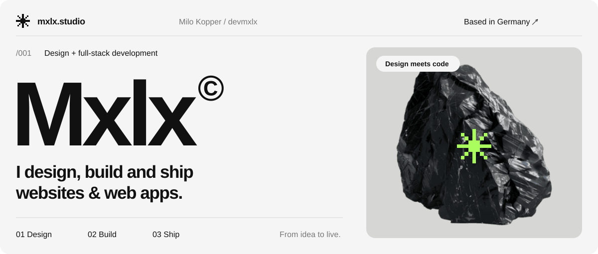
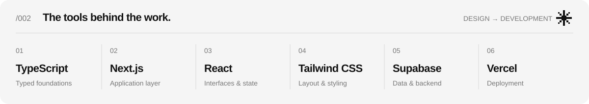
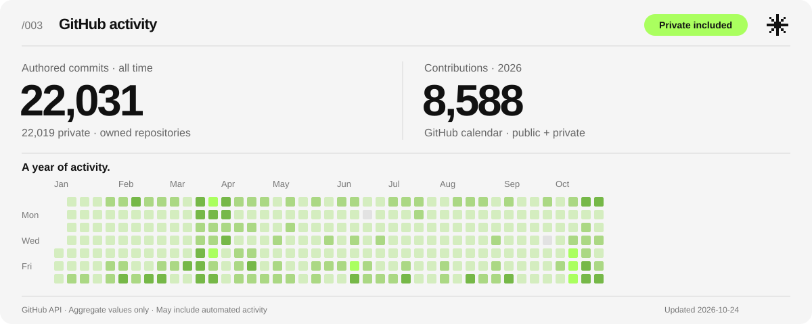
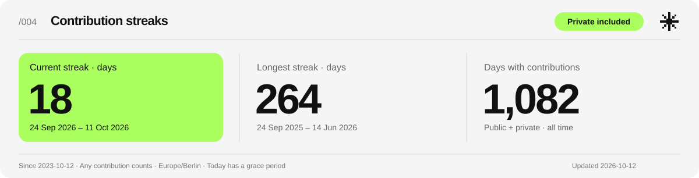
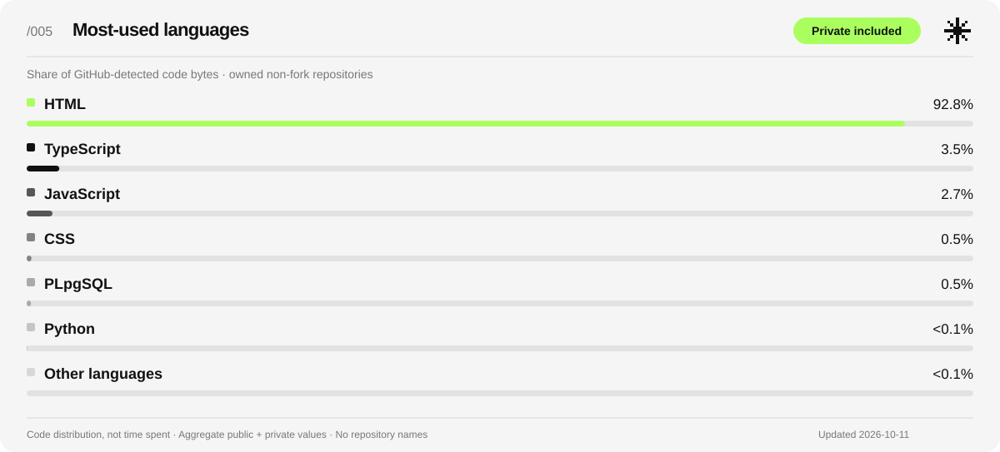
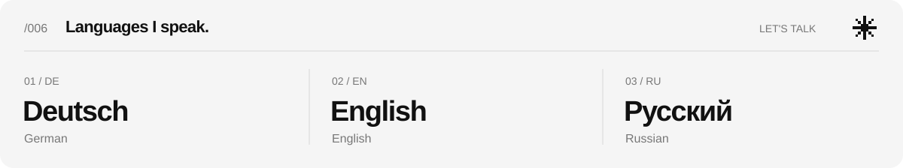

<p align="center">
  
</p>

<p align="center">
  <a href="#about"><strong>About</strong></a> ·
  <a href="#stack"><strong>Stack</strong></a> ·
  <a href="#building"><strong>What I build</strong></a> ·
  <a href="#workflow"><strong>Workflow</strong></a> ·
  <a href="#stats"><strong>Stats</strong></a> ·
  <a href="#contact"><strong>Contact</strong></a>
</p>

<p align="center">
  <a href="https://mxlx.studio"><strong>Explore Mxlx — my studio & portfolio ↗</strong></a>
</p>

---

<a id="about"></a>
## Hey, I'm Milo.

I'm a **developer from Germany** who designs and builds custom websites and web apps. I work across the whole product: the interface people use, the backend behind it, the data it depends on, and the deployment that brings everything online.

I'm also the founder of **[Mxlx](https://mxlx.studio)**, my digital agency. The studio brings together web design, UI/UX, branding, prototyping and the work that keeps a website useful after launch.

I enjoy taking an idea through to something people can actually use. My approach combines visual design with hands-on engineering, and I build my projects from concept to deployment.

```typescript
type Developer = {
  name: string;
  handle: string;
  basedIn: string;
  studio: string;
  builds: readonly string[];
  coreStack: readonly string[];
  openTo: readonly string[];
  spokenLanguages: readonly string[];
  portfolio: `https://${string}`;
};

const milo = {
  name: "Milo Kopper",
  handle: "devmxlx",
  basedIn: "Germany",
  studio: "Mxlx — Digital Agency",
  builds: ["custom websites", "web apps", "full-stack products"],
  coreStack: ["TypeScript", "Next.js", "React", "Tailwind", "Supabase", "Vercel"],
  openTo: ["freelance projects", "collaborations"],
  spokenLanguages: ["German", "English", "Russian"],
  portfolio: "https://mxlx.studio",
} as const satisfies Developer;
```

### What interests me

- **Interfaces:** making pages clear, responsive and comfortable to use.
- **Full-stack development:** connecting the UI, application logic and data into one working product.
- **Design and engineering:** working through both how a product looks and how it behaves.
- **Shipping:** getting an application online, then improving it through use and iteration.
- **Learning by building:** exploring tools through projects and understanding the systems behind them.

<a id="stack"></a>
## My toolkit

<p>
  
</p>

| Layer | My core tools | How I use them |
| :--- | :--- | :--- |
| **Language** | TypeScript, JavaScript | Application logic, shared types and the connection between frontend and backend |
| **Frontend** | React, Next.js | Components, routing, interactive interfaces and complete web applications |
| **Styling** | Tailwind CSS, HTML, CSS | Layout, responsive design, spacing, typography and reusable visual patterns |
| **Backend & data** | Supabase, PostgreSQL, Node.js | Data storage, backend integration and application services |
| **Deployment** | Vercel, Git, GitHub | Version control, previews, releases and production deployments |
| **Design** | Figma, Framer | Interface exploration, layouts and the visual side of a product |

<details>
  <summary><strong>More tools I've worked with</strong></summary>

<br />

My broader toolkit also includes **Python, GraphQL, SQLite, Vite, Radix UI, Three.js, React Native, WordPress, C, C++, C# and Java**. The core stack above is the clearest picture of the web products I focus on.

I choose tools around the requirements of a project: the interface, the data, the interaction, and how the product will be maintained.

</details>

<a id="building"></a>
## What I build

| Product | What I work on |
| :--- | :--- |
| **Custom websites** | Design, responsive layouts, reusable sections and the implementation behind the page |
| **Web applications** | Interactive interfaces, application logic, data-backed features and deployment |
| **Complete full-stack products** | The connection between frontend, backend, database and infrastructure |
| **Tools & automation** | Scripts and workflows that take repetitive work out of a project |

### Selected work

**[mxlx.studio ↗](https://mxlx.studio)** is the place to explore my agency, selected work and the websites and web apps I build.

| Case study | Focus |
| :--- | :--- |
| **[M.D. Alltagsunterstützung](https://mxlx.studio/cases/md-alltagsunterstuetzung)** | Local services |
| **[ABICRACK](https://mxlx.studio/cases/abicrack)** | Education |
| **[Yùyàn](https://mxlx.studio/cases/yuyan)** | Hospitality |
| **[VAULT](https://mxlx.studio/cases/vault)** | Social gaming |

Some of my development happens in private repositories. The activity section below includes aggregate private statistics while keeping those repositories and their contents private.

<a id="workflow"></a>
## How I approach a project

```text
  01 / UNDERSTAND       →  goal · audience · requirements
  02 / DESIGN           →  structure · layout · interactions
  03 / BUILD            →  interface · logic · data
  04 / VERIFY           →  behavior · responsive states · edge cases
  05 / SHIP             →  deployment · feedback · iteration
```

### Principles I aim for

**Make the interface understandable.** A page should make its purpose and the next action clear. I care about hierarchy, spacing and the smaller interactions that make a product comfortable to use.

**Keep the implementation readable.** Clear names, explicit types and focused components help me understand a codebase and keep improving it.

**Think through the entire flow.** A button, an API and a database entry are parts of the same feature. I work through how they connect, including loading, empty and error states.

**Pay attention to the finish.** Responsive layouts, keyboard access, useful feedback and deployment details are part of building the product.

**Leave room to improve.** Shipping creates a chance to learn from the result and refine the next version.

<details>
  <summary><strong>A typical full-stack flow</strong></summary>

<br />

```text
  User interaction
         │
         ▼
  React / Next.js interface
         │
         ▼
  Application logic & input validation
         │
         ▼
  Backend services / Supabase
         │
         ▼
  PostgreSQL data
         │
         └──→ Result, feedback and an updated interface

  Git + GitHub → preview → Vercel deployment
```

This is an overview of the layers I work across; the details depend on the application.

</details>

<a id="stats"></a>
## GitHub activity

<p>
  <a href="https://github.com/devmxlx?tab=overview">
    
  </a>
</p>

<details>
  <summary><strong>How to read these stats</strong></summary>

<br />

- **Commits** are GitHub's contributor commit counts for my own non-fork repositories, across their full history. Only commits attributed to my account are summed. Public and private repositories are included; work in repositories owned by other accounts is outside this counter.
- **Contributions** come from GitHub's contribution calendar for the displayed year. They can also include pull requests, issues, reviews and other eligible activity.
- **Private activity** is included in the aggregate values. Repository names, commit messages, source code and credentials are not part of the published statistics files.
- GitHub caches contributor counts, which can lag recent commits by a few hours. The two counters have different scopes and are not added together. The graph includes synthetic, automated commits with backdated author dates; these do not represent development work performed on those dates.
- The date on the card shows when the snapshot was generated. The updater is maintained in this profile repository.
- During the contributor-cache delay after a large import, a temporary aggregate lower bound from verified Git history keeps the new commits included. It expires within two days. Contribution-calendar and streak values always come directly from GitHub.

</details>

### Contribution streaks

<p>
  
</p>

### Most-used languages

<p>
  
</p>

<details>
  <summary><strong>How streaks and languages are calculated</strong></summary>

<br />

- **Streaks:** consecutive calendar days with at least one GitHub contribution. Any eligible public or private contribution counts, including synthetic automated history. The queried history starts on 12 October 2023 to cover imported author dates before account creation; a streak can continue across New Year.
- **Current streak:** includes today when it has activity. If today is still empty, a streak ending yesterday remains current until the day ends in Europe/Berlin.
- **Longest streak:** the longest consecutive run in that history. **Active days** counts all days with contributions, including days outside a streak.
- **Languages:** a measured source-file snapshot across accessible public, private and local projects, including projects that are not hosted on GitHub. Files are classified with scc; percentages use source-file bytes. Dependency folders, native SDK dependencies, build output, generated/minified files, exact duplicates and imported HTML learning pages are excluded. TypeScript includes TSX, JavaScript includes JSX, and SQL files are shown as SQL. Comments-only files are excluded. Percentages do not measure work hours, proficiency or individual authorship.
- **Language scan date:** the date on this card is the actual local scan date. GitHub Actions preserves the last full source snapshot; it cannot scan projects that only exist on a powered-off computer. A new local scan updates those projects. Commits, contributions and streaks continue to refresh automatically four times daily.
- Only aggregate numbers are published, with no private repository names, paths, commit messages or source files. The six largest languages are shown individually; smaller ones are grouped when necessary.

</details>

<a id="contact"></a>
## Let's build something.

I'm open to **freelance projects and collaborations**, especially custom websites, web apps and work that connects design with full-stack development.

We can talk in **German, English or Russian**.

<p>
  
</p>

| Find me | Link |
| :--- | :--- |
| **Studio & portfolio** | [mxlx.studio](https://mxlx.studio) |
| **Project enquiries** | [Start a project](https://mxlx.studio/contact) |
| **Business email** | [info@mxlx.studio](mailto:info@mxlx.studio) |
| **GitHub** | [@devmxlx](https://github.com/devmxlx) |

<br />

<p align="center">
  <strong>Design it. Build it. Ship it. Keep learning.</strong><br />
  <sub>Milo · devmxlx · Germany</sub>
</p>
